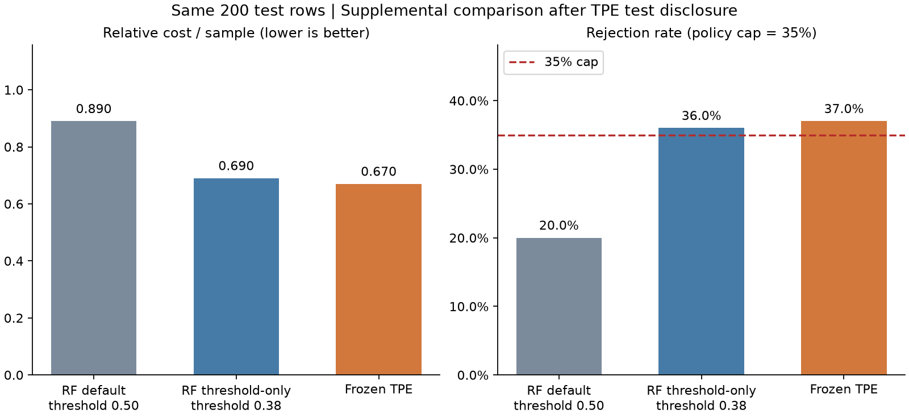
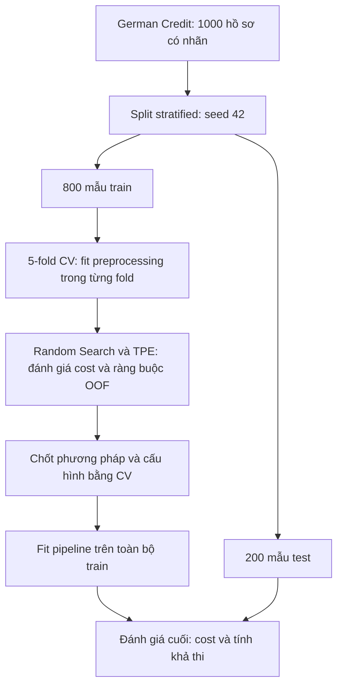
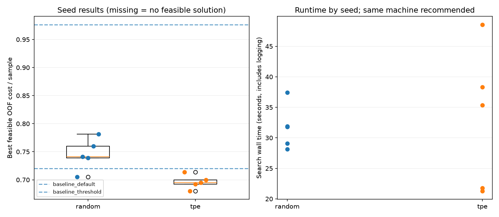
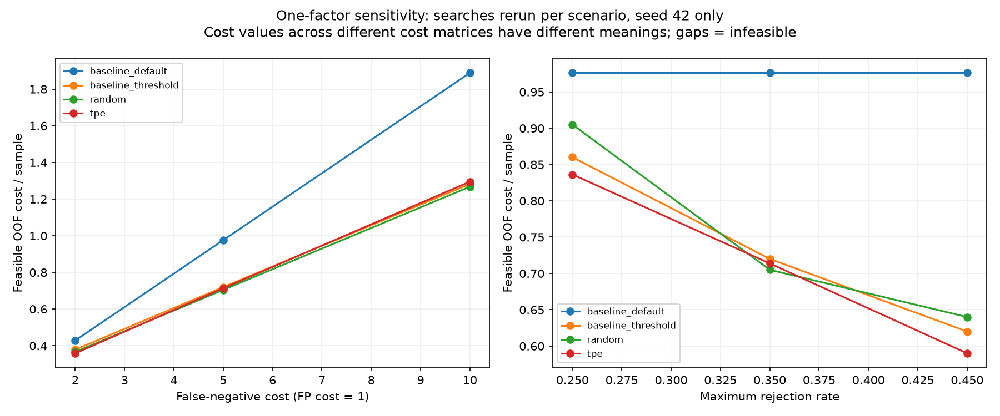
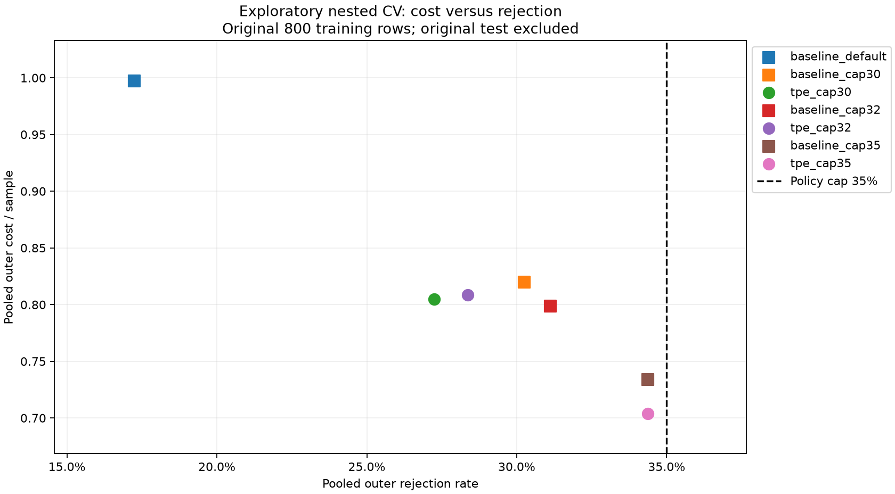
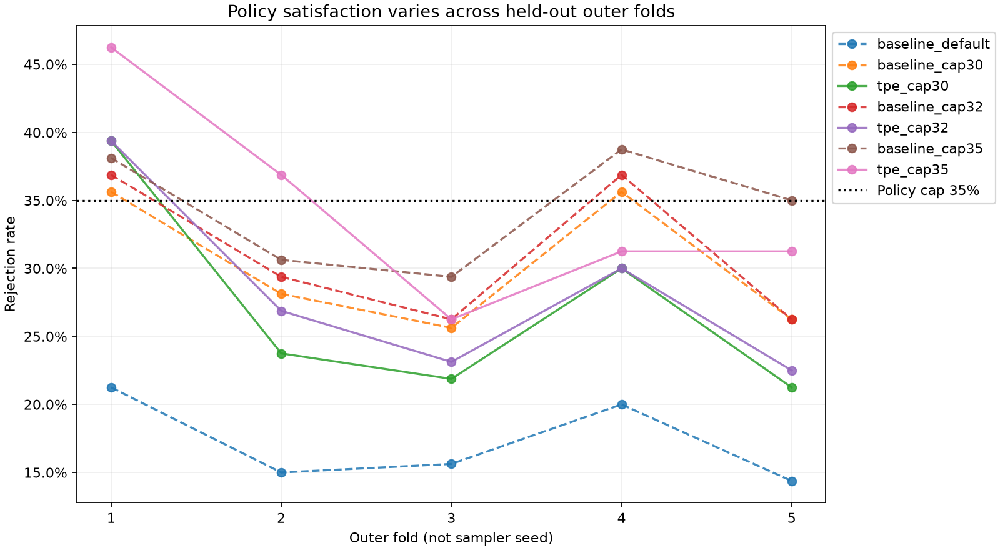

# Cost-Sensitive Credit Risk Optimization

**Tối ưu chi phí phân loại tín dụng dưới ràng buộc tỷ lệ phê duyệt**

Đồ án cá nhân môn **Nhập môn Tối ưu hóa** — Đỗ Hoàng Phúc, chuyên ngành Trí tuệ nhân tạo, Trường Đại học Văn Lang.

Dự án sử dụng Random Forest để phân loại hồ sơ tín dụng, kết hợp Random Search và Optuna TPE để tìm ngưỡng phân loại và siêu tham số có chi phí sai lầm thấp dưới ràng buộc tỷ lệ từ chối.

**Kết quả chính:** mô hình TPE đạt chi phí test **0.67/mẫu**, thấp hơn hai baseline trong phép so sánh bổ sung, nhưng từ chối **37%** hồ sơ, vượt trần giả định **35%**. Vì vậy, mô hình chưa đáp ứng đầy đủ ràng buộc trên tập test.

**Tiến độ:** đã hoàn thành thực nghiệm tuần 1–5, so sánh baseline bổ sung và nested cross-validation. Các phần này đã được push tại [commit f1aa54c](https://github.com/dohoangphuc2006/credit-risk-cost-sensitive-optimization/commit/f1aa54c1a57f7c16e5f71609841dc7547e81cf0f). Báo cáo đơn giản và phần bảo vệ cá nhân còn cần hoàn thiện.

## 1. Bài toán và mục tiêu

Đây là **bài toán học có giám sát**: dữ liệu có nhãn `0 = good`, `1 = bad`. Mô hình dự đoán xác suất thuộc lớp bad; quyết định dự đoán `1` tương ứng từ chối hồ sơ.

| Sai lầm | Diễn giải | Chi phí tương đối |
| --- | --- | ---: |
| False Negative (FN) | Phê duyệt hồ sơ thuộc lớp bad | 5 |
| False Positive (FP) | Từ chối hồ sơ thuộc lớp good | 1 |

Ma trận chi phí 5:1 dựa trên tài liệu German Credit của UCI. Đây là chi phí benchmark, không phải tiền thiệt hại được đo tại ngân hàng. Trần từ chối **35%**, tương đương phê duyệt ít nhất **65%**, là giả định chính sách của nghiên cứu.

**Câu hỏi nghiên cứu:** tối ưu đồng thời ngưỡng phân loại và siêu tham số Random Forest có giảm chi phí so với mô hình mặc định và phương án chỉ tối ưu ngưỡng, trong khi đáp ứng ràng buộc tỷ lệ từ chối hay không?

Gọi cấu hình quyết định là $z=(\tau,n,d,s,w)$:

| Biến | Tham số | Miền tìm kiếm |
| --- | --- | --- |
| $\tau$ | Ngưỡng từ chối: $\hat y_i=1$ nếu $P(bad\mid u_i)\ge\tau$ | $[0.10,0.90]$ |
| $n$ | `n_estimators` | Số nguyên 20–200 |
| $d$ | `max_depth` | Số nguyên 2–15 |
| $s$ | `min_samples_split` | Số nguyên 2–20 |
| $w$ | `class_weight={0: 1.0, 1: w}` | $[1,10]$ |

Hàm mục tiêu và ràng buộc được tính trên **dự đoán out-of-fold (OOF) của 800 mẫu train**. Mỗi mẫu nhận dự đoán từ một mô hình không được huấn luyện bằng mẫu đó:

$$\min_{z\in\Omega} f(z)=\frac{5FN_{OOF}(z)+FP_{OOF}(z)}{800}$$

$$g(z)=\frac{TP_{OOF}(z)+FP_{OOF}(z)}{800}-0.35\le0.$$

Tìm kiếm dùng objective phạt, giữ riêng chi phí gốc $f$ để báo cáo:

$$J(z)=\begin{cases}f(z),&g(z)\le0,\\5+f(z)+10g(z),&g(z)>0.\end{cases}$$

Chỉ chọn nghiệm khả thi. Nếu hòa trong cùng seed, ưu tiên ít cây hơn, độ sâu nhỏ hơn rồi trial xuất hiện trước. Xem [mô hình hóa tuần 1](report/week1_formulation.md) và [cấu hình thực nghiệm](configs/experiment.json).

## 2. Kết quả trên tập test

Sau khi chọn cấu hình bằng train CV, pipeline TPE được fit lại một lần trên toàn bộ 800 mẫu train và đánh giá trên **200 mẫu test**. Hai baseline sau đó được đánh giá bổ sung trên cùng các row IDs, với ngưỡng lịch sử giữ nguyên.

| Phương án | Ngưỡng | Cost/mẫu ↓ | FN | FP | Recall bad | Từ chối | Đạt trần 35% |
| --- | ---: | ---: | ---: | ---: | ---: | ---: | --- |
| RF mặc định | 0.50 | 0.89000 | 33 | 13 | 45.00% | 20.00% | **Có** |
| RF tối ưu ngưỡng bằng OOF | 0.38 | 0.69000 | 21 | 33 | 65.00% | 36.00% | Không |
| **TPE đã khóa** | 0.5454772140992292 | **0.67000** | **20** | 34 | **66.67%** | 37.00% | Không |

Chi phí TPE là `(5 × 20 + 34) / 200 = 0.67`. Mô hình từ chối **74/200 hồ sơ**, vượt mức tối đa 70 hồ sơ đúng **4 hồ sơ / 2 điểm phần trăm**. Accuracy là 73%, macro-F1 là 0.69700; ma trận nhầm lẫn có TN=106, FP=34, FN=20, TP=40.

Trên tập test này, TPE có chi phí thấp hơn RF mặc định **24.72%** và baseline tối ưu ngưỡng **2.90%**. So với baseline ngưỡng 0.38, TPE bỏ sót ít hơn một mẫu bad nhưng từ chối nhầm thêm một mẫu good.

**Diễn giải:** TPE giảm chi phí quan sát được nhưng chưa đạt ràng buộc trên test. Trong ba phương án, chỉ RF mặc định đáp ứng trần 35%. Chưa thể kết luận TPE là phương án khả thi tốt nhất hoặc có khác biệt có ý nghĩa thống kê.

**Thời điểm so sánh:** hai baseline được đánh giá sau khi đã xem test TPE. Baseline dùng một RF mặc định fit trên train và hai ngưỡng đã xác định từ tuần 2; không quét ngưỡng trên test. Đây là phân tích bổ sung, không phải so sánh đăng ký trước. Kết quả test không được dùng để thay mô hình đã khóa.

[Bảng so sánh](results/week5/baseline_test/comparison.csv) · [Dự đoán cùng row IDs](results/week5/baseline_test/predictions.csv) · [Metrics TPE](results/week5/test_metrics.json) · [Nhật ký TPE](results/week5/test_evaluation.json) · [Nhật ký baseline](results/week5/baseline_test/evaluation.json)



## 3. Dữ liệu và thiết kế thực nghiệm

- **Dataset:** Statlog (German Credit Data), 1.000 mẫu, 20 đặc trưng; [OpenML ID 31](https://www.openml.org/d/31), phiên bản 1.
- **Nguồn gốc và ma trận chi phí:** [UCI German Credit](https://archive.ics.uci.edu/dataset/144/statlog+german+credit+data).
- **Citation:** Hofmann, H. (1994). Statlog (German Credit Data). UCI Machine Learning Repository. [DOI: 10.24432/C5NC77](https://doi.org/10.24432/C5NC77).
- **Giấy phép:** [CC BY 4.0](https://creativecommons.org/licenses/by/4.0/), theo trang UCI.
- **Split:** stratified train/test 80/20, seed 42; train có 560 good/240 bad, test có 140 good/60 bad.
- **CV chính:** 5 folds phân tầng cố định trên train, shuffle, seed 42.
- **Preprocessing:** imputer và One-Hot encoder nằm trong pipeline; fit trên phần train của từng fold.
- **Truy vết:** lưu source row IDs, folds, cấu hình, phiên bản môi trường và SHA-256. Dùng các CSV đặc trưng gốc trong repo; file cũ `german_credit_data.csv` không tham gia thực nghiệm.



Xem [mô tả dữ liệu](data/README.md). Tính hash hoặc ghi thống kê split không phải đánh giá mô hình trên test.

## 4. Tìm kiếm và cấu hình được chọn

**Random Search** lấy cấu hình ngẫu nhiên trong miền biến. **TPE** dùng lịch sử trials để đề xuất cấu hình tiếp theo. Cả hai dùng cùng search space, folds, preprocessing, RF seed 42 và ngân sách **50 trials/sampler seed**. TPE có 10 trials khởi tạo nằm trong ngân sách 50; chạy tuần tự, không pruning.

Thực nghiệm chính dùng 5 sampler seeds: `42, 100, 2024, 2025, 2026`. Mỗi trial fit 5 mô hình CV; mỗi phương pháp có 250 trials, tương ứng 1.250 lần fit. Năm sampler seeds đo biến động của tìm kiếm trên cùng split, không đo đầy đủ bất định dữ liệu.

| Phương án | Cost OOF dùng để so sánh | Sample SD | Seeds có nghiệm khả thi |
| --- | ---: | ---: | ---: |
| RF mặc định, ngưỡng 0.50 | 0.97625 | — | — |
| RF chỉ tối ưu ngưỡng 0.38 | 0.72000 | — | — |
| Random Search: mean best feasible qua 5 seeds | 0.74525 | 0.02825 | 5/5 |
| TPE: mean best feasible qua 5 seeds | **0.69625** | **0.01225** | 5/5 |

TPE có chi phí thấp hơn trong 4/5 cặp seeds. Riêng seed 42 ở tuần 3, Random Search tốt hơn: 0.70500 so với TPE 0.71375. Không có phương pháp thắng mọi lần chạy.

Quy tắc chọn phương pháp được ghi rõ **sau khi xem CV, trước test**: phương pháp tìm kiếm phải có nghiệm khả thi ở đủ 5 seeds; chọn mean cost thấp nhất khi so với baseline tối ưu ngưỡng. Nếu hòa trong 1e-12, ưu tiên baseline tối ưu ngưỡng, Random Search rồi TPE. Đây không phải quy tắc đăng ký trước khi xem CV.

Trong TPE, chọn trial khả thi có cost thấp nhất; nếu hòa, ưu tiên ít cây, độ sâu nhỏ, thứ tự seed trong config rồi trial nhỏ hơn.

| Cấu hình đã khóa | Giá trị |
| --- | --- |
| Phương pháp / sampler seed / trial | TPE / 100 / 47 (trial thứ 48) |
| `threshold` | 0.5454772140992292 |
| `n_estimators` / `max_depth` / `min_samples_split` | 107 / 10 / 17 |
| `class_weight` | `{0: 1.0, 1: 2.6301556120420058}` |
| RF `random_state` | 42 |
| Cost / tỷ lệ từ chối OOF của trial | 0.68000 / 34.25% |

Cost OOF 0.68 là điểm của cấu hình được chọn trên dữ liệu dùng để tìm kiếm; cần phân biệt với mean TPE 0.69625 và test cost 0.67. Feasibility trên OOF chưa bảo đảm feasibility trên dữ liệu mới.

[Quyết định chọn](results/week5/selection.json) · [Mô hình đã fit](results/week5/final_model.joblib) · [Metadata fit](results/week5/fit_metadata.json) · [Bảng OOF/test](results/week5/oof_vs_test.csv)

### Logs và phân tích tuần 3–4

- [Tuần 3, seed 42](results/week3/run-20261108T052245407488Z/): lịch sử trials, best feasible và đồ thị hội tụ.
- [Tuần 4 có checkpoint](results/week4/run-20261108T104055472068Z/): kết quả chính qua 5 seeds và 8 tìm kiếm độ nhạy mới. Seed 42 được tái sử dụng từ tuần 3; tổng 16 tìm kiếm mới, 4.000 fits mới và 500 fits tái sử dụng.
- [Lần tuần 4 trước checkpoint](results/week4/run-20261108T055756731500Z/) được giữ để truy vết. Cùng seeds và cùng kết quả không được cộng thành 10 seeds độc lập.

Runtime trung bình của lần tuần 4 có checkpoint là Random Search 31.66 giây, TPE 33.05 giây; chịu ảnh hưởng tải máy và chi phí ghi log. Độ nhạy chạy seed 42 với FN=2/10 hoặc trần từ chối 25%/45%. Khi FN=10, Random Search và baseline tối ưu ngưỡng đều có cost thấp hơn TPE. So sánh cost chỉ trong cùng ma trận chi phí.




## 5. Nghiên cứu bổ sung: khoảng đệm và nested CV

Sau khi quan sát vi phạm trần trên test cũ, nghiên cứu bổ sung thử trần lựa chọn **30%, 32%, 35%** bằng nested cross-validation trên **800 mẫu train gốc**. Chương trình chặn mở `credit_test.csv`. Nested CV tách vòng lựa chọn và vòng đánh giá trong thí nghiệm mới, nhưng nghiên cứu vẫn mang tính khám phá sau khi đã xem test cũ; chia lại dữ liệu đã dùng không tạo ra test độc lập mới.

Theo [protocol bổ sung](configs/robustness.json), vòng ngoài có 5 folds, seed 20261109; mỗi fold dùng 640 mẫu train và 160 mẫu validation. Trong 640 mẫu train, vòng trong có 3 folds, seed 20261110, để chọn cấu hình/ngưỡng. Nhãn validation ngoài không được dùng để lựa chọn. Xem [hướng dẫn nested CV của scikit-learn](https://scikit-learn.org/stable/auto_examples/model_selection/plot_nested_cross_validation_iris.html).

Mỗi mức trần chạy TPE riêng, 50 trials, sampler/RF seed 42. Baseline chọn lại ngưỡng bằng inner OOF trên lưới 0.10–0.90 bước 0.01, thay vì dùng ngưỡng 0.38 chọn từ toàn bộ 800 mẫu. **Chính sách đánh giá ngoài luôn là trần 35%.**

| Phương án | Trần inner OOF | Cost vòng ngoài/mẫu | Từ chối vòng ngoài | Folds đạt trần 35% |
| --- | ---: | ---: | ---: | ---: |
| RF mặc định, ngưỡng 0.50 | — | 0.99750 | 17.250% | **5/5** |
| RF chọn ngưỡng | 30% | 0.82000 | 30.250% | 3/5 |
| RF chọn ngưỡng | 32% | 0.79875 | 31.125% | 3/5 |
| RF chọn ngưỡng | 35% | 0.73375 | 34.375% | 3/5 |
| TPE | 30% | 0.80500 | **27.250%** | **4/5** |
| TPE | 32% | 0.80875 | 28.375% | **4/5** |
| TPE | 35% | **0.70375** | 34.375% | 3/5 |

Đã hoàn tất **15 tìm kiếm, 750 trials và 2.285 fits**: 2.250 fits tìm kiếm, 15 fits CV baseline và 20 refits để dự đoán ngoài. Cả bảy phương án có đủ 800 dự đoán ngoài, mỗi mẫu đúng một dự đoán/phương án. Không có nghiệm inner khả thi thì ghi thiếu dự đoán, không nới trần hoặc dùng cost 0; chỉ báo pooled score khi đủ coverage.

**Kết quả:** với TPE, trần lựa chọn 30% giảm tỷ lệ từ chối ngoài 7.125 điểm phần trăm so với trần 35%, nhưng cost tăng từ 0.70375 lên 0.80500 và recall bad giảm từ 63.33% xuống 53.75%. Vẫn có một fold từ chối **39.375%**. Khoảng đệm cải thiện mức đáp ứng quan sát được nhưng chưa bảo đảm mọi fold đạt chính sách.

Cả bảy phương án đạt trần khi gộp 800 dự đoán; chỉ RF mặc định đạt trên mọi fold. Năm folds ngoài không phải năm sampler seeds độc lập. Không so trực tiếp các điểm này với test cost 0.67 do khác dữ liệu đánh giá và quy trình lựa chọn. Chưa chọn mô hình triển khai mới từ các điểm ngoài này; cần dữ liệu chưa dùng để xác nhận độc lập một phương án được chốt tiếp theo.

[Bảng tổng hợp](results/robustness/run-20261109T024250942600Z/aggregate.csv) · [Điểm từng fold](results/robustness/run-20261109T024250942600Z/per_fold.csv) · [Dự đoán ngoài](results/robustness/run-20261109T024250942600Z/outer_predictions.csv) · [Metadata](results/robustness/run-20261109T024250942600Z/run_metadata.json)




## 6. Cài đặt và kiểm tra kết quả

Mở thư mục gốc dự án trong VS Code, chọn **Terminal → New Terminal**. Môi trường thực nghiệm dùng **Python 3.12.10**; các phiên bản thư viện được lưu trong [requirements-lock.txt](requirements-lock.txt).

```powershell
python -m venv .venv
.\.venv\Scripts\python.exe -m pip install -r requirements-lock.txt
```

Dữ liệu và folds đã có trong repo. Dùng môi trường tương ứng để kiểm tra mô hình đã lưu. Chỉ nạp file joblib hoặc checkpoint từ nguồn tin cậy.

### Đọc và xác minh kết quả đã hoàn tất

```powershell
.\.venv\Scripts\python.exe -m src.evaluate_final
.\.venv\Scripts\python.exe -m src.evaluate_baselines
.\.venv\Scripts\python.exe -m src.robustness --resume results/robustness/run-20261109T024250942600Z
```

Với artifact đã hoàn tất và checksum còn đúng, các lệnh trên xác minh/hiển thị kết quả, không fit hoặc đánh giá test lại. JSON chọn/fit ghi `test_evaluated: false` phản ánh thời điểm trước test; trạng thái cuối nằm trong `test_evaluation.json`. Nhận xét chưa có baseline trong JSON test TPE ban đầu cũng phản ánh thời điểm đánh giá đầu; so sánh cập nhật nằm tại `results/week5/baseline_test/`.

### Chạy lại thực nghiệm

| Lệnh sau `python.exe -m` | Tác dụng |
| --- | --- |
| `src.baseline` | Tính lại hai baseline bằng train CV; cập nhật kết quả tuần 2 |
| `src.optimize` | Tạo run tuần 3 mới: Random Search và TPE, 50 trials/method, seed 42 |
| `src.week4` | Tạo run tuần 4 mới, bổ sung seeds và độ nhạy, tái sử dụng seed 42 đã xác minh |
| `src.robustness` | Tạo run nested CV mới, chỉ dùng train gốc |
| `src.robustness_plot` | Vẽ bản trình bày từ aggregate CSV đã xác minh, không fit |

Không cần chạy lại thực nghiệm chỉ để xem kết quả. `src.baseline` có thể ghi lại artifact mà các bước sau dùng checksum; nếu muốn tái lập toàn bộ, nên dùng bản sao riêng của repo và chạy theo thứ tự. Chỉ tái tạo dữ liệu bằng `src.data_utils --force` khi chủ động muốn thay artifact và có kết nối nguồn dữ liệu.

`src.finalize select` và `src.finalize fit` dành cho bản dự án chưa có artifact tuần 5; từ chối ghi đè quyết định/mô hình đã khóa. Khi suy luận, dùng `predict_with_threshold` trong `src/final_model.py` để áp đúng ngưỡng đã lưu; `pipeline.predict()` dùng ngưỡng mặc định khác quyết định của dự án.

### Kiểm thử và checkpoint

```powershell
.\.venv\Scripts\python.exe -m unittest discover -s tests -v
```

Bộ mã có 43 kiểm thử bằng dữ liệu giả, gồm objective, logs, thống kê seeds, checkpoint/resume, chọn cấu hình, lưu/nạp mô hình, bảo vệ holdout và tách vòng trong/ngoài. Các kiểm thử không dùng test thật làm fixture.

Để tiếp tục một run đang dở, dùng đúng đường dẫn đã in trên terminal:

```powershell
.\.venv\Scripts\python.exe -m src.week4 --resume "results/week4/run-THOI_GIAN_CUA_BAN"
.\.venv\Scripts\python.exe -m src.robustness --resume "results/robustness/run-THOI_GIAN_CUA_BAN"
```

`search.checkpoint.json` lưu Optuna Study, trạng thái sampler/RNG và trial đang dở. File này chỉ dùng nội bộ trên máy và bị Git bỏ qua; repo công khai có logs và kết quả để kiểm tra. Giữ nguyên code, config, dữ liệu, môi trường và chỉ mở một process/run khi resume. Trial đang dở có thể được tính lại; các bước baseline/refit của fold chưa lưu xong cũng có thể chạy lại. Runtime resume có thể thiếu phần tính toán trước checkpoint cuối.

JSON/CSV tìm kiếm được ghi nguyên tử với retry cho lỗi file tạm thời trên Windows/OneDrive. `.gitattributes` cố định kiểu xuống dòng cho các artifact có checksum, gồm ngoại lệ CRLF của dữ liệu/log cũ.

## 7. Tiến độ và cấu trúc repository

| Giai đoạn | Sản phẩm | Trạng thái |
| --- | --- | --- |
| Tuần 1 | Mô hình hóa, config, dữ liệu, split và CV folds | Hoàn tất, đã push |
| Tuần 2 | Baseline, OOF, notebook và đồ thị | Hoàn tất, đã push; kết quả chính chạy bằng CLI |
| Tuần 3 | Objective, Random Search/TPE seed 42, logs và hội tụ | Hoàn tất, đã push |
| Tuần 4 | 5 sampler seeds, độ nhạy, thống kê và checkpoint | Hoàn tất, đã push |
| Tuần 5 | Quyết định chọn, refit train, mô hình và test | Hoàn tất thực nghiệm, đã push |
| Bổ sung | Baseline trên test và khoảng đệm/nested CV | Hoàn tất, đã push tại `f1aa54c` |
| Bản nộp học phần | Báo cáo đơn giản và bảo vệ cá nhân | Cần hoàn thiện |

```text
configs/       Cấu hình chính và protocol robustness
src/           Chuẩn bị dữ liệu, baseline, tối ưu, đánh giá, phân tích
notebooks/     Notebook baseline; kết quả chính được tạo bằng CLI
results/       Baseline, week3/, week4/, week5/, robustness/
figures/       Các đồ thị baseline tuần 2
tests/        Kiểm thử bằng dữ liệu giả
report/        week1_formulation.md; chưa có báo cáo tổng kết
data/         Train/test gốc, metadata, folds và README nguồn dữ liệu
```

## 8. Giới hạn

- German Credit là benchmark nhỏ, công bố năm 1994; chưa đại diện cho tín dụng Việt Nam hiện nay. Nhãn bad không chứng minh hành vi cố tình không trả nợ.
- Chi phí tương đối 5:1 và trần từ chối 35% là giả định; chưa có đánh giá hiệu quả tài chính hay thẩm định để triển khai thực tế.
- TPE cuối chưa đạt trần trên test. Khoảng đệm giảm tỷ lệ từ chối trong thí nghiệm bổ sung nhưng vẫn có fold vi phạm.
- Năm sampler seeds trên một split và nested CV trên train gốc chưa bao quát thay đổi phân phối dữ liệu. Chưa có kiểm định ý nghĩa thống kê hoặc chứng minh nghiệm tối ưu toàn cục.
- Hai baseline test và nghiên cứu khoảng đệm được bổ sung sau khi đã xem test TPE; giữ rõ thời điểm và giới hạn khi diễn giải.
