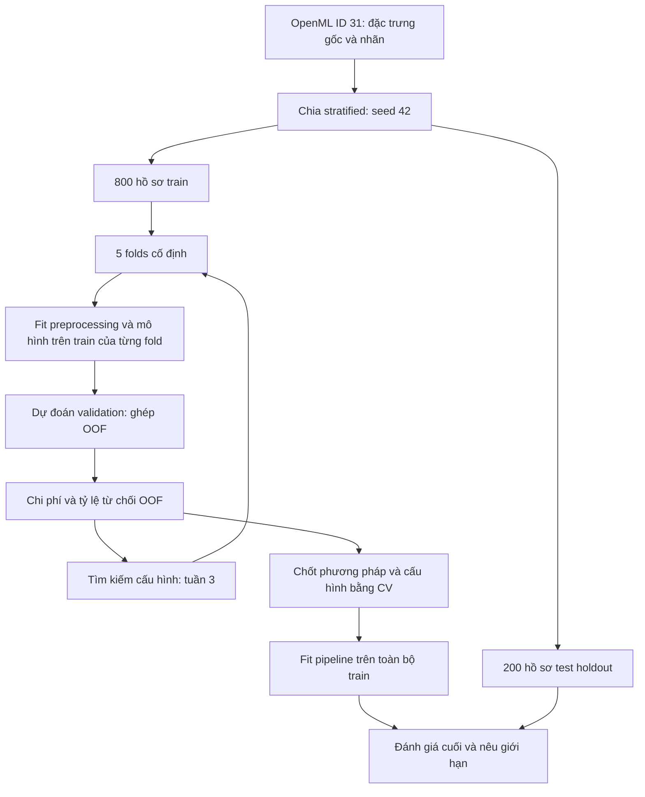

# Cost-Sensitive Credit Risk Optimization

**Tối ưu chi phí phân loại tín dụng dưới ràng buộc tỷ lệ phê duyệt**

Bài tập lớn cá nhân môn Nhập môn Tối ưu hóa, thực hiện trong 5 tuần.

- **Sinh viên:** Đỗ Hoàng Phúc
- **Chuyên ngành:** Trí tuệ nhân tạo, Trường Đại học Văn Lang
- **Sản phẩm:** GitHub repository gồm mã nguồn, mô hình hóa, log và hình kết quả.
- **Checkpoint:** Đã chạy baseline tuần 2, tạo kết quả OOF, hình và metadata; chờ kiểm tra thay đổi và commit/push.

## 1. Problem

Trong phân loại tín dụng, hai loại sai lầm có thể mang chi phí khác nhau.
Với nhãn `0 = good`, `1 = bad`, quyết định dự đoán `1` tương ứng với từ chối:

| Sai lầm | Diễn giải trong nghiên cứu | Chi phí tương đối |
| --- | --- | ---: |
| False Negative (FN) | Chấp thuận hồ sơ thuộc lớp tín dụng xấu | 5 |
| False Positive (FP) | Từ chối hồ sơ thuộc lớp tín dụng tốt | 1 |

Ma trận 5:1 lấy từ tài liệu German Credit của UCI. Đây là chi phí benchmark,
không phải số tiền thiệt hại đã đo tại một ngân hàng.

**Câu hỏi nghiên cứu:** Với giả định phải phê duyệt ít nhất 65% hồ sơ, tối ưu
đồng thời ngưỡng phân loại và siêu tham số Random Forest có giảm chi phí so
với mô hình mặc định và phương án chỉ tối ưu ngưỡng không?

## 2. Optimization formulation

Gọi cấu hình quyết định là $z=(\tau,n,d,s,w)$; ký hiệu $\mathbf{u}_i$ dành
cho đặc trưng hồ sơ để tránh nhầm với vector cấu hình.

| Biến | Ý nghĩa | Miền tìm kiếm |
| --- | --- | --- |
| $\tau$ | Ngưỡng từ chối: $\hat y_i=1$ nếu $p_i\ge\tau$ | $[0.10,0.90]$ |
| $n$ | `n_estimators` | Số nguyên từ 20 đến 200 |
| $d$ | `max_depth` | Số nguyên từ 2 đến 15 |
| $s$ | `min_samples_split` | Số nguyên từ 2 đến 20 |
| $w$ | Trọng số lớp xấu | $[1,10]$, ánh xạ `class_weight={0: 1.0, 1: w}` |

Trên toàn bộ dự đoán out-of-fold (OOF) của **800 hồ sơ train**:

$$\min_{z\in\Omega} f(z)=\frac{5\,FN_{\mathrm{OOF}}(z)+FP_{\mathrm{OOF}}(z)}{N_{\mathrm{train}}}$$

$$g(z)=\frac{TP_{\mathrm{OOF}}(z)+FP_{\mathrm{OOF}}(z)}{N_{\mathrm{train}}}-0.35\le0.$$

Mức phê duyệt 65% là **giả định chính sách của nghiên cứu**, không phải quy
định chung của ngành ngân hàng. Với cùng mô hình, giảm $\tau$ làm tỷ lệ từ
chối tăng hoặc giữ nguyên, FN giảm hoặc giữ nguyên, FP tăng hoặc giữ nguyên.

Kế hoạch tối ưu dùng objective phạt cho trial không khả thi; lựa chọn cuối
chỉ xét các trial đáp ứng ràng buộc. Công thức phạt, quy tắc hòa điểm và
protocol được ghi tại [mô hình hóa tuần 1](report/week1_formulation.md).
Đây là thiết kế cho tuần 3; chưa có kết quả tối ưu ở checkpoint tuần 1.

## 3. Dataset and protocol

- **Dataset:** Statlog (German Credit Data), 1.000 mẫu, 20 đặc trưng.
- **Nguồn cố định:** [OpenML ID 31](https://www.openml.org/d/31), `credit-g`.
- **Nguồn gốc và ma trận chi phí:** [UCI](https://archive.ics.uci.edu/dataset/144/statlog+german+credit+data).
- **Citation:** Hofmann, H. (1994). Statlog (German Credit Data). UCI Machine Learning Repository. [DOI: 10.24432/C5NC77](https://doi.org/10.24432/C5NC77).
- **Giấy phép dữ liệu:** [CC BY 4.0](https://creativecommons.org/licenses/by/4.0/), theo trang UCI; giữ ghi nguồn khi chia sẻ.
- **Chia dữ liệu:** stratified 80% train / 20% test, seed 42; giữ `source_row_id` để truy vết.
- **CV:** 5 folds phân tầng cố định trên train, shuffle và seed 42.
- **Preprocessing:** chia dữ liệu trước; tạo One-Hot encoder và imputer trong `Pipeline` của từng fold. Tuần 1 chỉ tạo transformer chưa fit.
- **Test holdout:** chỉ đánh giá sau khi chốt phương pháp và cấu hình bằng train CV. Tính hash và ghi thống kê chia dữ liệu không phải đánh giá mô hình trên test.



Hai CSV train/test đã được tạo lại với đặc trưng chưa mã hóa.
Metadata có `artifact_format_version = 2`; đã lưu năm CV folds và kiểm tra
checksum của dữ liệu, folds và cấu hình. Loader từ chối artifact v1.
CSV `german_credit_data.csv` cũ có 9 đặc trưng và không có nhãn đích; không
được dùng trong pipeline này. Xem [mô tả dữ liệu](data/README.md).

## 4. Baselines and optimization plan

| Phương án dự kiến | Vai trò |
| --- | --- |
| RF mặc định, `class_weight=None`, $\tau=0.5$ | Baseline ban đầu |
| RF mặc định, ngưỡng chọn bằng OOF trên lưới 0.10 đến 0.90, bước 0.01 | Xác định đóng góp riêng của ngưỡng |
| Random Search, tối ưu 5 biến | Đối chứng thuật toán tìm kiếm |
| Optuna TPE, tối ưu 5 biến | Phương pháp chính |

Random Search và TPE dùng cùng search space, folds, preprocessing và ngân sách
**50 trials / sampler seed**, lặp với `42, 100, 2024, 2025, 2026`.
Seed mô hình RF giữ ở 42 để tập trung đo biến động do thuật toán tìm kiếm.
Một trial fit 5 mô hình theo CV; tương ứng 1.250 lần fit cho mỗi phương pháp
khi chạy đủ 5 sampler seeds. Số lần fit và runtime sẽ được ghi lại.

Tất cả phương án được báo cùng cost/sample, FN, FP, recall lớp bad, tỷ lệ
phê duyệt và tính khả thi. RF mặc định vẫn được báo nếu vi phạm ràng buộc,
nhưng không được xem là một phương án triển khai khả thi.

## 5. Key results and five-week plan

### Bảng kết quả thực nghiệm Baseline (Tuần 2)

Thực nghiệm trên 800 mẫu Train qua 5-Fold Stratified CV cố định (Ma trận chi phí $C_{\mathrm{FN}} = 5$, $C_{\mathrm{FP}} = 1$; Ràng buộc Rejection Rate $\le 35\%$):

| Chỉ số thực nghiệm | RF mặc định ($\tau = 0.50$) | Baseline tối ưu ngưỡng ($\tau^* = 0.38$) | Chênh lệch / Cải thiện |
| :--- | :---: | :---: | :---: |
| **Chi phí trung bình / mẫu $f(z)$** | **0.9762** | **0.7200** | **-26.25% (Tiết kiệm chi phí)** |
| Tổng chi phí tổn thất (800 mẫu) | 781 đơn vị | 576 đơn vị | Giảm 205 đơn vị chi phí |
| False Negative (lọt nợ xấu - phạt 5) | 146 ca | 90 ca | Giảm 56 mẫu bad bị bỏ sót |
| False Positive (từ chối nhầm - phạt 1)| 51 ca | 126 ca | Tăng 75 ca từ chối nhầm |
| Tỷ lệ từ chối hồ sơ $r(z)$ | 18.12% | 34.50% | Thỏa mãn ràng buộc $\le 35\%$ |
| Tỷ lệ phê duyệt hồ sơ | 81.88% | 65.50% | Thỏa giả định phê duyệt $\ge 65\%$ |
| Tính khả thi (Feasible?) | **Có (Khả thi)** | **Có (Khả thi)** | Cả hai đều nằm trong miền khả thi |
| Recall nhận diện nợ xấu (Class 1) | 39.17% | 62.50% | Tăng 23.33 điểm phần trăm |
| Macro-F1 score | 0.6631 | 0.6911 | Tăng +0.0280 |

> **Kết quả trước lần chỉnh code:** Bảng này khớp với kết quả baseline đã lưu sau khi chạy phiên bản mới.

> **Nhận xét tối ưu:** Trên OOF của tập train, ngưỡng được chọn trong lưới giúp giảm 26.25% chi phí theo ma trận giả định 5:1, đồng thời thỏa tỷ lệ từ chối ≤35%. Đây là kết quả lựa chọn cấu hình trên cùng OOF, chưa được xác nhận trên test độc lập và không chứng minh mức tiết kiệm tiền thật. Tuần 3 sẽ so sánh Random Search và TPE với mốc này.


### Lộ trình 05 Tuần

| Tuần | Nội dung | Sản phẩm trong repo | Trạng thái |
| :--- | :--- | :--- | :---: |
| **1** | Chốt câu hỏi, mô hình hóa toán học, nguồn dữ liệu, split/CV chống rò rỉ và pipeline tiền xử lý | `src/data_utils.py`, `report/week1_formulation.md`, `configs/experiment.json`, data v2 | ✅ Hoàn thành |
| **2** | Chạy thực nghiệm Baseline mặc định và Baseline quét ngưỡng trên 5-Fold CV; trực quan hóa đồ thị | `src/baseline.py`, `notebooks/01_baseline.ipynb`, `results/`, `figures/` | Đã chạy; chờ commit/push |
| **3** | Cài đặt hàm mục tiêu có phạt (Penalty Function), chạy Random Search và Optuna TPE trên 5 biến | Source tối ưu, log trials CSV/JSON, đồ thị hội tụ Best-so-far | 📅 Dự kiến |
| **4** | Thực nghiệm trên 5 sampler seeds; phân tích độ ổn định (Boxplot) và độ nhạy chi phí | Bảng thống kê mean/std, phân tích trade-off và sensitivity | 📅 Dự kiến |
| **5** | Chốt cấu hình tối ưu theo CV, đánh giá khách quan trên 200 mẫu Test, hoàn thiện Portfolio | Bảng so sánh toàn diện, kiểm chứng Test set, đóng gói Release `v1.0` | 📅 Dự kiến |

Tài liệu mô hình hóa nằm trong repository; sản phẩm của dự án là repo GitHub.

## 6. How to run (PowerShell)

Mở terminal tại thư mục gốc repo. Nếu đã có môi trường và dữ liệu tuần 1, chỉ chạy:

```powershell
.\.venv\Scripts\python.exe -m src.baseline
```

Lệnh cập nhật hai JSON baseline, bảng `threshold_sweep.csv`, ba hình và thêm:
- `results/baseline_oof.csv`: row ID, nhãn thật, fold và xác suất bad của từng mẫu train.
- `results/baseline_run_metadata.json`: thời gian, seed/config, phiên bản thư viện,
  tham số mô hình và checksum dữ liệu train, folds, code, kết quả.

Khi cài lần đầu trên máy khác:

```powershell
python -m venv .venv
.\.venv\Scripts\python.exe -m pip install -r requirements-lock.txt
```

Dùng dữ liệu và folds đã lưu trong repo. Chỉ khi cần tạo lại dữ liệu, chạy
`.\.venv\Scripts\python.exe -m src.data_utils --force`; lệnh này ghi đè artifact
và có thể cần Internet. Không cần chạy lại chuẩn bị dữ liệu mỗi lần chạy baseline.

Để dùng notebook trong VS Code, cài extension Python và Jupyter, cài kernel:

```powershell
.\.venv\Scripts\python.exe -m pip install ipykernel
```

Mở `notebooks/01_baseline.ipynb`, chọn kernel `.venv`, chọn **Run All**, rồi lưu.
Notebook gọi cùng pipeline với CLI để tạo đồng bộ kết quả và hình; chọn một trong
hai cách chạy là đủ. Notebook chưa được thực thi lại sau lần chỉnh sửa này.

Đầu ra của lần chuẩn bị dữ liệu thành công (đường dẫn rút gọn):

```text
Prepared OpenML ID 31 in <repository>/data
Train: 800 rows; test: 200 rows.
Saved 5 fixed CV folds and SHA-256 checksums.
Features are unencoded. No model training or test evaluation has been performed.
```

Đọc lại train và folds, không huấn luyện mô hình:

```powershell
.\.venv\Scripts\python.exe -c "from src.data_utils import load_training_data, load_cv_splits; X, y = load_training_data(); folds = load_cv_splits(X); print('Train shape:', X.shape); print('Labels:', y.value_counts().to_dict()); print('CV folds:', len(folds))"
```

Kỳ vọng: train `(800, 20)`, nhãn `{0: 560, 1: 240}`, 5 folds.
Metadata v2 lưu cấu hình, phiên bản môi trường, row IDs và SHA-256 của các file.
Khi thay config, cần tạo lại artifact; không đổi split để chọn kết quả đẹp hơn.

Sau khi chạy thành công, lưu phiên bản môi trường và cập nhật trạng thái checkpoint:

```powershell
.\.venv\Scripts\python.exe -m pip freeze | Out-File -Encoding utf8 requirements-lock.txt
```

Người khác có thể cài lại môi trường Python tương ứng bằng
`python -m pip install -r requirements-lock.txt`. File này đã được sinh viên
tạo sau khi cài thư viện và chuẩn bị dữ liệu thành công.

## 7. Repository structure

```text
credit-risk-cost-sensitive-optimization/
├── README.md
├── requirements.txt
├── requirements-lock.txt        # Phiên bản thư viện của môi trường đã chạy
├── .gitignore
├── configs/
│   └── experiment.json          # Config chuẩn: data, seeds, costs, policy, budget
├── src/
│   ├── __init__.py
│   ├── config.py                # Đọc và kiểm tra config
│   ├── data_utils.py            # Chuẩn bị dữ liệu; đọc train và CV folds
│   └── preprocessing.py         # Transformer chưa fit, dùng trong pipeline CV
├── data/
│   ├── README.md
│   ├── credit_train.csv         # 800 mẫu với đặc trưng chưa mã hóa
│   ├── credit_test.csv
│   ├── dataset_metadata.json
│   ├── cv_folds.json            # Năm folds đã lưu từ lần chạy v2
│   └── german_credit_data.csv   # File cũ, không dùng trong thực nghiệm
├── notebooks/
├── results/
├── figures/
└── report/
    └── week1_formulation.md     # Ghi chú mô hình hóa trong repo
```

## 8. Limitations and AI assistance

- German Credit là benchmark nhỏ, công bố năm 1994; không đại diện cho tín dụng
  Việt Nam hiện nay. Nhãn bad không chứng minh hành vi cố tình không trả nợ.
- Chi phí 5:1 và mức phê duyệt 65% không đủ để suy ra tiết kiệm tiền thật.
- Feasibility trên CV không đảm bảo tỷ lệ phê duyệt tương lai; test cuối phải
  báo cả chi phí lẫn mức vi phạm ràng buộc, nếu có.
- Năm sampler seeds đo độ ổn định tìm kiếm trên một split/CV cố định,
  không đo đầy đủ bất định lấy mẫu hay thay đổi phân phối dữ liệu.
- **AI assistance:** AI hỗ trợ mô hình hóa, viết/chỉnh code chuẩn bị dữ liệu,
  preprocessing và tài liệu tuần 1. Sinh viên đã chạy chuẩn bị dữ liệu v2
  và lưu phiên bản môi trường; dữ liệu và checksum đã được kiểm tra khi
  cập nhật checkpoint. Đã có kết quả baseline tuần 2; AI hỗ trợ sửa lỗi notebook,
  bổ sung log và diễn giải kết quả. Sinh viên đã chạy lại phiên bản chỉnh sửa và tạo kết quả OOF cùng metadata.
  Chưa có kết quả Random Search/TPE hoặc đánh giá test.
  Sinh viên chịu trách nhiệm hiểu và giải thích từng bước của dự án.

## 9. Commit and push after running

Sau khi chạy tuần 2 thành công, kiểm tra bảng số liệu mới, cập nhật checkpoint và
trạng thái tuần 2 ở trên. Chỉ giữ con số trong bảng nếu khớp JSON vừa xuất.

```powershell
git status --short
git diff --check
git add README.md src/baseline.py notebooks/01_baseline.ipynb results/baseline_default.json results/baseline_threshold_sweep.json results/threshold_sweep.csv results/baseline_oof.csv results/baseline_run_metadata.json figures/week2_cm_baseline_default.png figures/week2_cm_baseline_threshold_opt.png figures/week2_cost_vs_threshold.png
git diff --cached --stat
git commit -m "feat(week2): add reproducible baselines and OOF analysis"
git push origin main
```

Nếu Git báo remote có commit mới, dùng `git pull --rebase origin main` rồi
`git push origin main`; nếu có conflict, xử lý conflict trước khi tiếp tục.
Không dùng force-push. Sau khi push, mở GitHub để xác nhận commit và các file mới.
