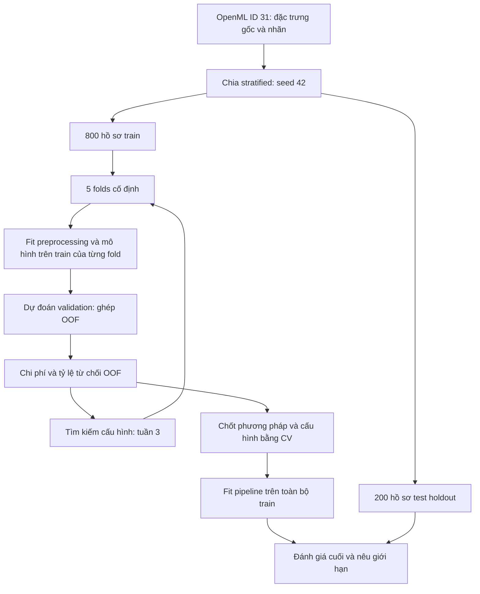
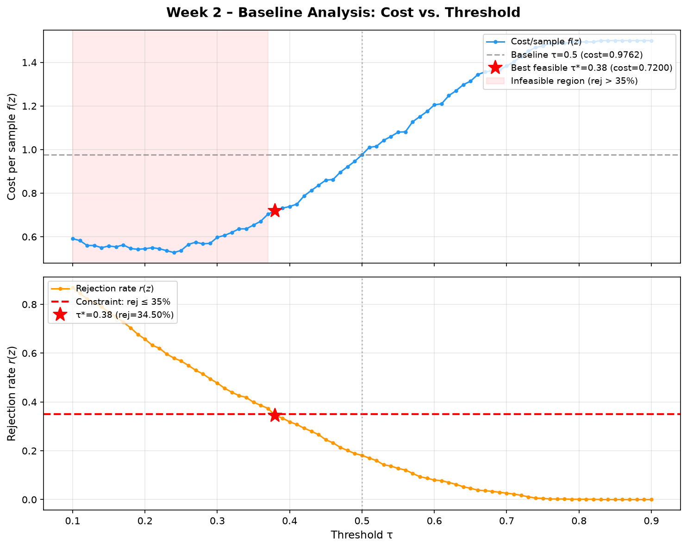
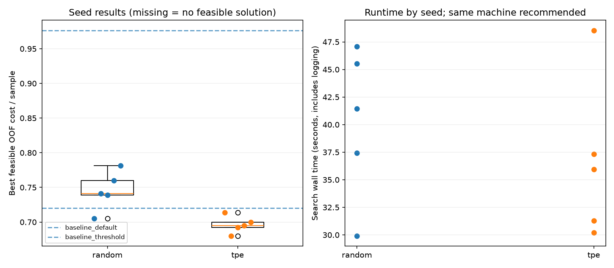
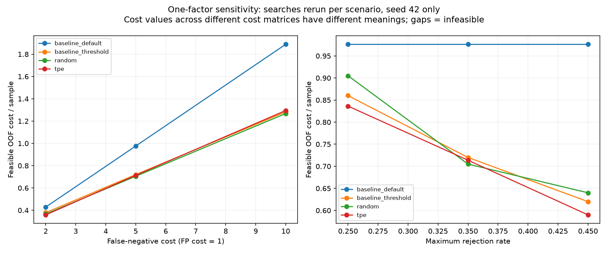

# Cost-Sensitive Credit Risk Optimization

**Tối ưu chi phí phân loại tín dụng dưới ràng buộc tỷ lệ phê duyệt**

Bài tập lớn cá nhân môn Nhập môn Tối ưu hóa, thực hiện trong 5 tuần.

- **Sinh viên:** Đỗ Hoàng Phúc
- **Chuyên ngành:** Trí tuệ nhân tạo, Trường Đại học Văn Lang
- **Sản phẩm:** GitHub repository gồm mã nguồn, mô hình hóa, log và hình kết quả.
- **Checkpoint:** Tuần 4 đã chạy đủ 5 seeds và 4 kịch bản độ nhạy; kết quả đã kiểm tra, chờ push. Checkpoint tiếp tục chạy đã được bổ sung sau thực nghiệm.

## 1. Problem

Trong phân loại tín dụng, hai loại sai lầm có thể mang chi phí khác nhau.
Với nhãn `0 = good`, `1 = bad`, quyết định dự đoán `1` tương ứng với từ chối:

| Sai lầm | Diễn giải trong nghiên cứu | Chi phí tương đối |
| --- | --- | ---: |
| False Negative (FN) | Chấp thuận hồ sơ thuộc lớp tín dụng xấu | 5 |
| False Positive (FP) | Từ chối hồ sơ thuộc lớp tín dụng tốt | 1 |

Ma trận 5:1 lấy từ tài liệu German Credit của UCI. Đây là chi phí benchmark,
không phải số tiền thiệt hại đã đo tại một ngân hàng.

**Câu hỏi nghiên cứu:** Với giả định phải phê duyệt ít nhất 65% hồ sơ, tối ưu
đồng thời ngưỡng phân loại và siêu tham số Random Forest có giảm chi phí so
với mô hình mặc định và phương án chỉ tối ưu ngưỡng không?

## 2. Optimization formulation

Gọi cấu hình quyết định là $z=(\tau,n,d,s,w)$; ký hiệu $\mathbf{u}_i$ dành
cho đặc trưng hồ sơ để tránh nhầm với vector cấu hình.

| Biến | Ý nghĩa | Miền tìm kiếm |
| --- | --- | --- |
| $\tau$ | Ngưỡng từ chối: $\hat y_i=1$ nếu $p_i\ge\tau$ | $[0.10,0.90]$ |
| $n$ | `n_estimators` | Số nguyên từ 20 đến 200 |
| $d$ | `max_depth` | Số nguyên từ 2 đến 15 |
| $s$ | `min_samples_split` | Số nguyên từ 2 đến 20 |
| $w$ | Trọng số lớp xấu | $[1,10]$, ánh xạ `class_weight={0: 1.0, 1: w}` |

Trên toàn bộ dự đoán out-of-fold (OOF) của **800 hồ sơ train**:

$$\min_{z\in\Omega} f(z)=\frac{5\,FN_{\mathrm{OOF}}(z)+FP_{\mathrm{OOF}}(z)}{N_{\mathrm{train}}}$$

$$g(z)=\frac{TP_{\mathrm{OOF}}(z)+FP_{\mathrm{OOF}}(z)}{N_{\mathrm{train}}}-0.35\le0.$$

Mức phê duyệt 65% là **giả định chính sách của nghiên cứu**, không phải quy
định chung của ngành ngân hàng. Với cùng mô hình, giảm $\tau$ làm tỷ lệ từ
chối tăng hoặc giữ nguyên, FN giảm hoặc giữ nguyên, FP tăng hoặc giữ nguyên.

Kế hoạch tối ưu dùng objective phạt cho trial không khả thi; lựa chọn cuối
chỉ xét các trial đáp ứng ràng buộc. Công thức phạt, quy tắc hòa điểm và
protocol được ghi tại [mô hình hóa tuần 1](report/week1_formulation.md).
Đã cài đặt trong `src/objective.py` và `src/optimize.py`; kết quả tuần 3 với seed 42 được trình bày bên dưới.

## 3. Dataset and protocol

- **Dataset:** Statlog (German Credit Data), 1.000 mẫu, 20 đặc trưng.
- **Nguồn cố định:** [OpenML ID 31](https://www.openml.org/d/31), `credit-g`.
- **Nguồn gốc và ma trận chi phí:** [UCI](https://archive.ics.uci.edu/dataset/144/statlog+german+credit+data).
- **Citation:** Hofmann, H. (1994). Statlog (German Credit Data). UCI Machine Learning Repository. [DOI: 10.24432/C5NC77](https://doi.org/10.24432/C5NC77).
- **Giấy phép dữ liệu:** [CC BY 4.0](https://creativecommons.org/licenses/by/4.0/), theo trang UCI; giữ ghi nguồn khi chia sẻ.
- **Chia dữ liệu:** stratified 80% train / 20% test, seed 42; giữ `source_row_id` để truy vết.
- **CV:** 5 folds phân tầng cố định trên train, shuffle và seed 42.
- **Preprocessing:** chia dữ liệu trước; tạo One-Hot encoder và imputer trong `Pipeline` của từng fold. Tuần 1 chỉ tạo transformer chưa fit.
- **Test holdout:** chỉ đánh giá sau khi chốt phương pháp và cấu hình bằng train CV. Tính hash và ghi thống kê chia dữ liệu không phải đánh giá mô hình trên test.



Hai CSV train/test đã được tạo lại với đặc trưng chưa mã hóa.
Metadata có `artifact_format_version = 2`; đã lưu năm CV folds và kiểm tra
checksum của dữ liệu, folds và cấu hình. Loader từ chối artifact v1.
CSV `german_credit_data.csv` cũ có 9 đặc trưng và không có nhãn đích; không
được dùng trong pipeline này. Xem [mô tả dữ liệu](data/README.md).

## 4. Baselines and optimization plan

| Phương án dự kiến | Vai trò |
| --- | --- |
| RF mặc định, `class_weight=None`, $\tau=0.5$ | Baseline ban đầu |
| RF mặc định, ngưỡng chọn bằng OOF trên lưới 0.10 đến 0.90, bước 0.01 | Xác định đóng góp riêng của ngưỡng |
| Random Search, tối ưu 5 biến | Đối chứng thuật toán tìm kiếm |
| Optuna TPE, tối ưu 5 biến | Phương pháp chính |

Random Search và TPE dùng cùng search space, folds, preprocessing và ngân sách
**50 trials / sampler seed**, lặp với `42, 100, 2024, 2025, 2026`.
Seed mô hình RF giữ ở 42 để tập trung đo biến động do thuật toán tìm kiếm.
Một trial fit 5 mô hình theo CV; tương ứng 1.250 lần fit cho mỗi phương pháp
khi chạy đủ 5 sampler seeds. Số lần fit và runtime sẽ được ghi lại.

Tất cả phương án được báo cùng cost/sample, FN, FP, recall lớp bad, tỷ lệ
phê duyệt và tính khả thi. RF mặc định vẫn được báo nếu vi phạm ràng buộc,
nhưng không được xem là một phương án triển khai khả thi.

## 5. Key results and five-week plan

### Bảng kết quả thực nghiệm Baseline (Tuần 2)

Thực nghiệm trên 800 mẫu Train qua 5-Fold Stratified CV cố định (Ma trận chi phí $C_{\mathrm{FN}} = 5$, $C_{\mathrm{FP}} = 1$; Ràng buộc Rejection Rate $\le 35\%$):

| Chỉ số thực nghiệm | RF mặc định ($\tau = 0.50$) | Baseline tối ưu ngưỡng ($\tau^* = 0.38$) | Chênh lệch / Cải thiện |
| :--- | :---: | :---: | :---: |
| **Chi phí trung bình / mẫu $f(z)$** | **0.9762** | **0.7200** | **-26.25% (Tiết kiệm chi phí)** |
| Tổng chi phí tổn thất (800 mẫu) | 781 đơn vị | 576 đơn vị | Giảm 205 đơn vị chi phí |
| False Negative (lọt nợ xấu - phạt 5) | 146 ca | 90 ca | Giảm 56 mẫu bad bị bỏ sót |
| False Positive (từ chối nhầm - phạt 1)| 51 ca | 126 ca | Tăng 75 ca từ chối nhầm |
| Tỷ lệ từ chối hồ sơ $r(z)$ | 18.12% | 34.50% | Thỏa mãn ràng buộc $\le 35\%$ |
| Tỷ lệ phê duyệt hồ sơ | 81.88% | 65.50% | Thỏa giả định phê duyệt $\ge 65\%$ |
| Tính khả thi (Feasible?) | **Có (Khả thi)** | **Có (Khả thi)** | Cả hai đều nằm trong miền khả thi |
| Recall nhận diện nợ xấu (Class 1) | 39.17% | 62.50% | Tăng 23.33 điểm phần trăm |
| Macro-F1 score | 0.6631 | 0.6911 | Tăng +0.0280 |

> **Kết quả đã kiểm tra:** Bảng này khớp với kết quả baseline đã lưu sau khi chạy phiên bản mới.

> **Nhận xét tối ưu:** Trên OOF của tập train, ngưỡng được chọn trong lưới giúp giảm 26.25% chi phí theo ma trận giả định 5:1, đồng thời thỏa tỷ lệ từ chối ≤35%. Đây là kết quả lựa chọn cấu hình trên cùng OOF, chưa được xác nhận trên test độc lập và không chứng minh mức tiết kiệm tiền thật. Tuần 3 sẽ so sánh Random Search và TPE với mốc này.



### Kết quả tuần 3: một sampler seed

Với seed 42, mỗi phương pháp đã chạy 50 trials trên cùng 5 folds train. Chi phí là đơn vị tương đối theo giả định FN:FP = 5:1; nghiệm được chọn phải có tỷ lệ từ chối không quá 35%.

| Phương pháp | Chi phí OOF / mẫu | FN | FP | Tỷ lệ từ chối | Trials khả thi |
| --- | ---: | ---: | ---: | ---: | ---: |
| RF mặc định | 0.97625 | 146 | 51 | 18.125% | — |
| RF tối ưu ngưỡng | 0.72000 | 90 | 126 | 34.500% | — |
| Random Search | 0.70500 | 90 | 114 | 33.000% | 19/50 |
| TPE | 0.71375 | 90 | 121 | 33.875% | 28/50 |

Random Search đạt chi phí thấp nhất trong lần chạy seed 42, thấp hơn baseline tối ưu ngưỡng khoảng 2.08%; TPE thấp hơn khoảng 0.87%. Đây là kết quả chọn cấu hình trên train OOF, chưa đánh giá test và chưa đủ để kết luận thuật toán nào ổn định hơn. Tuần 4 sẽ so sánh qua 5 sampler seeds.

[Bảng so sánh và log tuần 3](results/week3/run-20261108T052245407488Z/) · [Đồ thị best feasible](results/week3/run-20261108T052245407488Z/best_feasible_cost.png)

### Kết quả tuần 4

Đã kiểm tra đủ 16 lượt tìm kiếm mới và checksum đầu ra của lần chạy
[run-20261108T055756731500Z](results/week4/run-20261108T055756731500Z/).
Tổng hợp kịch bản chính qua 5 sampler seeds (bao gồm seed 42 tuần 3):

| Phương pháp | Chi phí OOF trung bình | Sample SD | Seeds khả thi | Thời gian trung bình (giây) |
| --- | ---: | ---: | ---: | ---: |
| Random Search | 0.74525 | 0.02825 | 5/5 | 40.28 |
| TPE | 0.69625 | 0.01225 | 5/5 | 36.65 |

TPE có chi phí thấp hơn trong 4/5 cặp seeds; mean thấp hơn Random Search khoảng
6.57% và thấp hơn baseline tối ưu ngưỡng (0.72) khoảng 3.30%. SD thấp hơn cho
thấy dao động nhỏ hơn trong 5 lần tìm kiếm này trên cùng split/CV. Chưa suy ra
ý nghĩa thống kê hay khả năng tổng quát trên test. Runtime chịu ảnh hưởng tải máy.

Độ nhạy seed 42: TPE đạt cost 0.35875 khi FN=2, 1.295 khi FN=10,
0.83625 khi trần từ chối=25%, và 0.59 khi trần=45%. Với FN=10, Random Search
(1.2675) và baseline tối ưu ngưỡng (1.2825) đều thấp hơn TPE. Vì vậy, không có
phương pháp thắng mọi kịch bản. So sánh cost chỉ trong cùng ma trận chi phí.




### Lộ trình 05 Tuần

| Tuần | Nội dung | Sản phẩm trong repo | Trạng thái |
| :--- | :--- | :--- | :---: |
| **1** | Chốt câu hỏi, mô hình hóa toán học, nguồn dữ liệu, split/CV chống rò rỉ và pipeline tiền xử lý | `src/data_utils.py`, `report/week1_formulation.md`, `configs/experiment.json`, data v2 | ✅ Hoàn thành |
| **2** | Chạy thực nghiệm Baseline mặc định và Baseline quét ngưỡng trên 5-Fold CV; trực quan hóa đồ thị | `src/baseline.py`, `notebooks/01_baseline.ipynb`, `results/`, `figures/` | Đã chạy và push |
| **3** | Cài đặt hàm mục tiêu có phạt (Penalty Function), chạy Random Search và Optuna TPE trên 5 biến | Source tối ưu, log trials CSV/JSON, đồ thị hội tụ Best-so-far | Đã chạy seed 42 và push |
| **4** | Thực nghiệm trên 5 sampler seeds; phân tích độ ổn định (Boxplot) và độ nhạy chi phí | Bảng thống kê mean/std, phân tích trade-off và sensitivity | Đã chạy và kiểm tra; chờ push |
| **5** | Chốt cấu hình tối ưu theo CV, đánh giá khách quan trên 200 mẫu Test, hoàn thiện Portfolio | Bảng so sánh toàn diện, kiểm chứng Test set, đóng gói Release `v1.0` | 📅 Dự kiến |

Tài liệu mô hình hóa nằm trong repository; sản phẩm của dự án là repo GitHub.

## 6. How to run (PowerShell)

Mở terminal tại thư mục gốc repo. Nếu đã có môi trường và dữ liệu tuần 1, chỉ chạy:

```powershell
.\.venv\Scripts\python.exe -m src.baseline
```

Lệnh cập nhật hai JSON baseline, bảng `threshold_sweep.csv`, ba hình và thêm:
- `results/baseline_oof.csv`: row ID, nhãn thật, fold và xác suất bad của từng mẫu train.
- `results/baseline_run_metadata.json`: thời gian, seed/config, phiên bản thư viện,
  tham số mô hình và checksum dữ liệu train, folds, code, kết quả.

Khi cài lần đầu trên máy khác:

```powershell
python -m venv .venv
.\.venv\Scripts\python.exe -m pip install -r requirements-lock.txt
```

Dùng dữ liệu và folds đã lưu trong repo. Chỉ khi cần tạo lại dữ liệu, chạy
`.\.venv\Scripts\python.exe -m src.data_utils --force`; lệnh này ghi đè artifact
và có thể cần Internet. Không cần chạy lại chuẩn bị dữ liệu mỗi lần chạy baseline.

Để dùng notebook trong VS Code, cài extension Python và Jupyter, cài kernel:

```powershell
.\.venv\Scripts\python.exe -m pip install ipykernel
```

Mở `notebooks/01_baseline.ipynb`, chọn kernel `.venv`, chọn **Run All**, rồi lưu.
Notebook gọi cùng pipeline với CLI để tạo đồng bộ kết quả và hình; chọn một trong
hai cách chạy là đủ. Notebook chưa được thực thi lại sau lần chỉnh sửa này.

Đầu ra của lần chuẩn bị dữ liệu thành công (đường dẫn rút gọn):

```text
Prepared OpenML ID 31 in <repository>/data
Train: 800 rows; test: 200 rows.
Saved 5 fixed CV folds and SHA-256 checksums.
Features are unencoded. No model training or test evaluation has been performed.
```

Đọc lại train và folds, không huấn luyện mô hình:

```powershell
.\.venv\Scripts\python.exe -c "from src.data_utils import load_training_data, load_cv_splits; X, y = load_training_data(); folds = load_cv_splits(X); print('Train shape:', X.shape); print('Labels:', y.value_counts().to_dict()); print('CV folds:', len(folds))"
```

Kỳ vọng: train `(800, 20)`, nhãn `{0: 560, 1: 240}`, 5 folds.
Metadata v2 lưu cấu hình, phiên bản môi trường, row IDs và SHA-256 của các file.
Khi thay config, cần tạo lại artifact; không đổi split để chọn kết quả đẹp hơn.

Sau khi chạy thành công, lưu phiên bản môi trường và cập nhật trạng thái checkpoint:

```powershell
.\.venv\Scripts\python.exe -m pip freeze | Out-File -Encoding utf8 requirements-lock.txt
```

Người khác có thể cài lại môi trường Python tương ứng bằng
`python -m pip install -r requirements-lock.txt`. File này đã được sinh viên
tạo sau khi cài thư viện và chuẩn bị dữ liệu thành công.

### Chạy tuần 3: Random Search và TPE

Ở thư mục gốc dự án, chạy:

```powershell
.\.venv\Scripts\python.exe -m src.optimize
```

Mặc định: **2 phương pháp × 50 trials × 5 folds = 500 lần fit RF**, sampler seed
42, RF seed 42. Giữ nguyên dữ liệu/folds/config tuần 1 và baseline tuần 2.
Không cần chuẩn bị lại dữ liệu. Code chỉ đọc train, không đọc CSV test.

Mỗi lần chạy tạo thư mục riêng `results/week3/run-<thời gian UTC>/` để không
đè kết quả cũ. Đường dẫn chính xác được in ở đầu và cuối terminal. Chờ dòng
`Finished` và kiểm tra `run_metadata.json` có `status: complete`.

| File trong thư mục chạy | Nội dung và cách đọc |
| --- | --- |
| `comparison.csv` | Hai baseline và nghiệm khả thi tốt nhất của mỗi phương pháp; cost càng thấp càng tốt |
| `best_feasible_cost.png` | Chi phí OOF khả thi tốt nhất sau mỗi trial; để trống trước khi có nghiệm khả thi |
| `summary.json` | Kết quả mỗi phương pháp/seed, số trials khả thi, số lần fit và runtime |
| `run_metadata.json` | Config, seeds, phiên bản thư viện, hash đầu vào/code/đầu ra, trạng thái chạy |
| `random_seed42/trials.csv`, `tpe_seed42/trials.csv` | Tham số, FN/FP/TP/TN, chi phí, tỷ lệ từ chối, f/g/J, tính khả thi, thời gian mỗi trial |
| `*/trials.json` | Cùng lịch sử và số liệu từng fold |
| `*/best_feasible.json`, `*/best_oof.csv` | Cấu hình được chọn và dự đoán OOF tương ứng; chỉ tạo nếu tìm thấy nghiệm khả thi |

Hàm mục tiêu thực hiện đúng thiết kế tuần 1:

$$J(z)=\begin{cases}f(z),&g(z)\le0,\\5+f(z)+10g(z),&g(z)>0.\end{cases}$$

`cost_per_sample` là $f$ chưa phạt; `objective` là $J$ dùng để tìm kiếm.
Mọi cấu hình vi phạm có $J>5$, còn cấu hình khả thi có $f\le5$.
Chọn cấu hình khả thi có chi phí thấp nhất; khi hòa trong cùng seed, ưu tiên
ít cây hơn, độ sâu nhỏ hơn rồi trial xuất hiện trước. Chưa chốt phương pháp
cuối cùng để đánh giá test ở tuần 3.

TPE dùng 10 trials khởi tạo ngẫu nhiên, sau đó tìm kiếm thích nghi; 10 trials
này **nằm trong ngân sách 50**. Cả hai phương pháp dùng cùng miền biến,
5 folds, RF seed và chạy tuần tự; không pruning, không dừng sớm. Chi phí
runtime gồm cả ghi log và được báo riêng với số lần fit. Baseline tối ưu
ngưỡng dùng lại OOF, nên ngân sách của baseline không được xem là 50 trials.

Nếu không tìm thấy nghiệm khả thi, báo `no feasible solution found within budget`;
không nới ràng buộc hay lấy nghiệm vi phạm thay thế. Nếu bị lỗi hoặc dừng bằng
Ctrl+C, log các trials đã xử lý vẫn được lưu và trạng thái đánh dấu chưa hoàn tất.
Chạy lại lệnh tạo một lần chạy mới; chưa hỗ trợ tiếp tục từ trial bị ngắt.
Giữ các lần chạy để truy vết, không chỉ giữ seed hoặc lần chạy đẹp nhất.

**Cách kết luận tuần 3:** Đối chiếu cost, FN, FP, recall bad, approval rate và
feasibility với hai baseline (0.97625 và 0.72000 ở tuần 2). Chấp nhận kết quả
không cải thiện nếu đúng thực nghiệm. Một sampler seed chưa đủ kết luận TPE
ổn định hơn Random Search; lặp 5 seeds và phân tích mean/std ở tuần 4. Chi phí
đang đo trên chính OOF dùng để chọn cấu hình, chưa là đánh giá test độc lập.

Lệnh kiểm tra code (dữ liệu giả, không tạo kết quả thực nghiệm chính):

```powershell
.\.venv\Scripts\python.exe -m unittest discover -s tests -v
```

Tám kiểm tra bao gồm biên ràng buộc, penalty, CV không chồng lấn, xử lý category
chưa xuất hiện, hòa điểm, tái lập samplers (có vượt qua 10 trials khởi tạo TPE),
trường hợp không có nghiệm, lưu lỗi và xuất file/đồ thị. Test cố ý gây lỗi
`fixture failure` để kiểm tra ghi log; toàn bộ bộ kiểm tra phải kết thúc bằng `OK`.

Tùy chọn `--trials 2` chỉ dành cho kiểm tra luồng chạy, không thay ngân sách
nộp bài; metadata ghi rõ ngân sách khác kế hoạch. Code cũng nhận nhiều seeds
qua `--seeds` để dùng ở tuần 4; tuần 3 chỉ cần lệnh mặc định ở trên.

### Chạy tuần 4: độ ổn định và độ nhạy

Chỉ cần chạy **một lần lệnh** dưới đây; chương trình tự chạy các seeds và kịch bản:

```powershell
.\.venv\Scripts\python.exe -m src.week4
```

Có thể kiểm tra dữ liệu, baseline và khả năng dùng lại tuần 3 trước (không train,
không tạo kết quả thực nghiệm):

```powershell
.\.venv\Scripts\python.exe -m src.week4 --check-only
```

Chương trình mặc định dùng lại seed 42 từ
`results/week3/run-20261108T052245407488Z`. Nó kiểm tra trạng thái hoàn tất,
50 trials mỗi phương pháp, config, phiên bản thư viện, checksum dữ liệu, code
và file kết quả. Không tự chọn lần chạy có kết quả đẹp nhất. Nếu các kiểm tra
không khớp, chương trình dừng để xử lý nguyên nhân; không tự bỏ qua kiểm tra.
`--reuse` cho phép chỉ định rõ một thư mục tuần 3 khác trong repo, nếu cần.

| Phần thực nghiệm | Cách thực hiện | Số lần fit RF mới |
| --- | --- | ---: |
| Độ ổn định kịch bản chính | Thêm seeds 100, 2024, 2025, 2026; 2 phương pháp × 50 trials × 5 folds | 2.000 |
| Độ nhạy | 4 kịch bản mới × 2 phương pháp × 50 trials × 5 folds, chỉ seed 42 | 2.000 |
| Tổng cần chạy mới ở tuần 4 | 800 trials | **4.000** |

Kịch bản chính giữ chi phí FN:FP = 5:1 và trần từ chối 35%. Độ nhạy thay **một
nhân tố mỗi lần**, không phải lưới 3×3:

- `fn2`: chi phí FN = 2; FP = 1; trần từ chối 35%.
- `fn10`: chi phí FN = 10; FP = 1; trần từ chối 35%.
- `rejection25`: chi phí 5:1; trần từ chối 25%.
- `rejection45`: chi phí 5:1; trần từ chối 45%.

Mỗi kịch bản chạy lại Random Search và TPE từ đầu bằng config hiệu lực riêng.
Config gốc, split và folds không bị ghi đè. Penalty dùng `max(C_FN, C_FP)` của
kịch bản đó. Baseline RF mặc định dùng lại xác suất OOF; tính lại chi phí và
chọn lại ngưỡng từ lưới cố định cho mỗi kịch bản, không cần fit lại RF. Kịch bản
chính seed 42 được dùng lại ở biểu đồ độ nhạy để tránh chạy trùng.

Mỗi lần chạy tạo `results/week4/run-<UTC>/` riêng. Khi kết thúc, terminal in
`Finished WEEK 4`, đường dẫn kết quả và bảng trung bình/độ lệch chuẩn. Đầu ra:

| File/thư mục | Ý nghĩa |
| --- | --- |
| `per_seed.csv` | 10 dòng: 2 phương pháp × 5 seeds; chi phí, FN/FP, recall, tỷ lệ phê duyệt, runtime và tham số tốt nhất |
| `aggregate.csv` | Mean và **sample SD (ddof=1)** qua các seed; số seed khả thi và số quan sát dùng cho từng chỉ số |
| `paired_differences.csv` | TPE trừ Random Search trong từng seed; số âm nghĩa là TPE có chi phí thấp hơn |
| `convergence.csv` | Chi phí tốt nhất theo số trial và số seed đã có nghiệm khả thi |
| `sensitivity.csv` | 5 kịch bản × 4 phương án; chỉ dùng seed 42 cho tìm kiếm |
| `main/`, `sensitivity/` | Log CSV/JSON của mỗi tìm kiếm, nghiệm tốt nhất và OOF tương ứng |
| `figures/seed_stability_runtime.png` | Phân bố kết quả giữa seeds và thời gian chạy |
| `figures/convergence_across_seeds.png` | Trung bình ± SD và tỷ lệ seed đã tìm thấy nghiệm khả thi |
| `figures/sensitivity.png` | Biến động chi phí khả thi theo chi phí FN/trần từ chối |
| `summary.json`, `run_metadata.json` | Số liệu tổng hợp, config kịch bản, tham chiếu/hash lần chạy tái sử dụng, trạng thái và hash đầu ra |
| `review.md` | Ghi chú kết quả tự sinh trong thư mục log, để hỗ trợ cập nhật README |

**Nguyên tắc đọc kết quả:**

- Giữ đủ cả 5 seeds. Nếu seed không tìm được nghiệm khả thi, ghi rõ thất bại và
  để trống chi phí; không thay bằng objective có phạt, 0 hoặc một cấu hình vi phạm.
  Mean/SD chi phí chỉ tính trên seed khả thi và luôn đi kèm số seed thành công.
- Biểu đồ hội tụ chỉ vẽ mean/SD khi cả 5 seeds đã có nghiệm khả thi, đồng thời
  vẽ tỷ lệ seed thành công. Dải SD mô tả dao động, không phải khoảng tin cậy.
- Các seeds đo ngẫu nhiên của quá trình tìm kiếm trên cùng split/CV, không đo
  đầy đủ bất định do dữ liệu. Không kết luận ý nghĩa thống kê từ 5 seeds đơn thuần.
- Runtime gồm ghi log; seed 42 được chạy trước đó nên khác tải máy có thể ảnh hưởng.
  Không đồng nhất search runtime với inference latency. Nên dùng cùng máy và môi trường.
- Trong độ nhạy, so sánh các phương pháp **trong cùng kịch bản**; tăng chi phí FN
  làm đổi thang đo mục tiêu. Chưa kiểm tra độ ổn định nhiều seeds cho độ nhạy.
- Tập test 200 mẫu vẫn được giữ cho tuần 5. Chưa tự động chốt mô hình cuối hoặc
  tuyên bố tìm được nghiệm tối ưu toàn cục/Pareto front.

### Tiếp tục chạy với checkpoint (các lần chạy mới)

Từ phiên bản này, tuần 4 lưu trạng thái Optuna Study, sampler/RNG, cấu hình trial
đang chờ và nghiệm tốt nhất trước/sau mỗi trial. Khi bị ngắt, dùng đúng thư mục
lần chạy đó:

```powershell
.\.venv\Scripts\python.exe -m src.week4 --resume "results/week4/run-THAY_BANG_THOI_GIAN_THUC_TE"
```

Trial hoàn thành không được tính/chạy lại; trial đang dở được đánh giá lại với
đúng cấu hình. Tìm kiếm đã đủ 50 trials chỉ xuất lại log từ checkpoint. Code kiểm
tra dữ liệu, config, môi trường và phiên bản code trước khi tiếp tục. Chỉ mở một
process cho mỗi thư mục chạy.

`search.checkpoint.json` là file nội bộ trên máy chứa trạng thái Python đã mã hóa;
chỉ dùng file do chính chương trình tạo, không tải và mở checkpoint từ nguồn lạ.
File này bị Git bỏ qua; các log CSV/JSON và OOF vẫn được commit. Thời gian khi resume
không bao gồm thời gian máy dừng, và có thể thiếu phần tính toán trước lần lưu cuối;
không dùng để khẳng định thuật toán nhanh hơn khi so với một lần chạy liền mạch.

Lần chạy hoàn chỉnh `run-20261108T055756731500Z` có trước tính năng checkpoint:
**không cần chạy lại**, và không thể tạo hồi tố trạng thái sampler cho lần đó.
Code đã vượt qua 22 kiểm tra, trong đó có ngắt/resume sau giai đoạn khởi tạo TPE
và so sánh toàn bộ lịch sử tham số với chạy liền mạch trên dữ liệu giả.

### Nếu Windows/OneDrive báo lỗi ghi log

JSON/CSV tìm kiếm và metadata tuần 4 được ghi vào file tạm cùng thư mục rồi
thay thế file đích, thử lại tối đa 6 lần khi gặp lỗi truy cập tạm thời (kể cả
`OSError: [Errno 22] Invalid argument`). Nếu thay thế thất bại, file log hoàn
chỉnh trước đó được giữ lại. Lỗi kéo dài vẫn được báo, không tự bỏ qua log.

Bản sửa chỉ đổi cách ghi file. Seed 42 tuần 3 được chấp nhận qua cặp hash
`optimize.py` cũ/mới đã đối chiếu; code tính objective và sampler vẫn giữ nguyên.
Các kiểm tra config, dữ liệu, môi trường và file kết quả vẫn được áp dụng.

Nếu lần chạy mới bị ngắt, giữ thư mục đó và dùng `--resume` như trên. Nếu lỗi ghi file tiếp tục,
có thể tạm dừng đồng bộ OneDrive trong lúc chạy, sau đó bật lại để đồng bộ.

## 7. Repository structure

```text
credit-risk-cost-sensitive-optimization/
├── README.md
├── requirements.txt
├── requirements-lock.txt        # Phiên bản thư viện của môi trường đã chạy
├── .gitignore
├── configs/
│   └── experiment.json          # Config chuẩn: data, seeds, costs, policy, budget
├── src/
│   ├── __init__.py
│   ├── config.py                # Đọc và kiểm tra config
│   ├── data_utils.py            # Chuẩn bị dữ liệu; đọc train và CV folds
│   ├── preprocessing.py         # Transformer dùng trong pipeline CV
│   ├── baseline.py              # Hai baseline tuần 2
│   ├── objective.py             # Đánh giá cấu hình bằng pooled OOF và penalty
│   ├── optimize.py              # Random Search / TPE, log và đồ thị
│   ├── week4.py                 # Tái sử dụng seed 42, bổ sung seeds và sensitivity
│   └── week4_analysis.py        # Thống kê, so sánh cặp seed và biểu đồ
├── data/
│   ├── README.md
│   ├── credit_train.csv         # 800 mẫu với đặc trưng chưa mã hóa
│   ├── credit_test.csv
│   ├── dataset_metadata.json
│   ├── cv_folds.json            # Năm folds đã lưu từ lần chạy v2
│   └── german_credit_data.csv   # File cũ, không dùng trong thực nghiệm
├── notebooks/
├── results/                    # Baseline, week3/run-<UTC>/, week4/run-<UTC>/
├── tests/
│   ├── test_optimization.py     # Kiểm tra bằng dữ liệu giả
│   └── test_week4.py            # Kiểm tra thống kê, reuse, sensitivity và xuất file
├── figures/
└── report/
    └── week1_formulation.md     # Ghi chú mô hình hóa trong repo
```

## 8. Limitations and AI assistance

- German Credit là benchmark nhỏ, công bố năm 1994; không đại diện cho tín dụng
  Việt Nam hiện nay. Nhãn bad không chứng minh hành vi cố tình không trả nợ.
- Chi phí 5:1 và mức phê duyệt 65% không đủ để suy ra tiết kiệm tiền thật.
- Feasibility trên CV không đảm bảo tỷ lệ phê duyệt tương lai; test cuối phải
  báo cả chi phí lẫn mức vi phạm ràng buộc, nếu có.
- Năm sampler seeds đo độ ổn định tìm kiếm trên một split/CV cố định,
  không đo đầy đủ bất định lấy mẫu hay thay đổi phân phối dữ liệu.
- **AI assistance:** AI hỗ trợ mô hình hóa, viết/chỉnh code chuẩn bị dữ liệu,
  preprocessing và tài liệu tuần 1. Sinh viên đã chạy chuẩn bị dữ liệu v2
  và lưu phiên bản môi trường; dữ liệu và checksum đã được kiểm tra khi
  cập nhật checkpoint. Đã có kết quả baseline tuần 2; AI hỗ trợ sửa lỗi notebook,
  bổ sung log và diễn giải kết quả. Sinh viên đã chạy lại phiên bản chỉnh sửa và tạo kết quả OOF cùng metadata.
  AI hỗ trợ cài đặt objective, Random Search/TPE và kiểm tra code tuần 3 bằng
  dữ liệu giả. Sinh viên đã chạy Random Search/TPE với seed 42; chưa đánh giá test.
  AI hỗ trợ triển khai tuần 4, kiểm tra dữ liệu giả và bổ sung checkpoint. Sinh viên
  đã chạy thực nghiệm tuần 4; AI kiểm tra kết quả và cập nhật diễn giải. Các kiểm tra giả không được dùng làm kết quả môn học.
  Sinh viên chịu trách nhiệm hiểu và giải thích từng bước của dự án.

## 9. Commit and push after running

Sau khi tuần 4 chạy thành công, kiểm tra `run_metadata.json` có `status: complete`,
đủ 10 dòng `per_seed.csv`, bảng tổng hợp và 3 hình. Cập nhật phần Key Results và
checkpoint từ số liệu thực tế; không ghi hoàn tất chỉ từ kết quả kiểm tra code.

Thay đường dẫn mẫu bằng thư mục chạy thực tế được in trong terminal:

```powershell
git status --short
git diff --check
git add README.md .gitignore src/week4.py src/week4_analysis.py src/optimize.py src/artifacts.py src/resumable_search.py tests/test_week4.py tests/test_artifacts.py tests/test_resume.py
git add "results/week4/run-20261108T055756731500Z"
git diff --cached --stat
git commit -m "feat(week4): analyze search stability and cost sensitivity"
git push origin main
```

Giữ file dữ liệu và các kết quả tuần 1–3 đã commit. Không cần đưa tài liệu học
của giảng viên vào commit thực nghiệm. Không dùng force-push.
